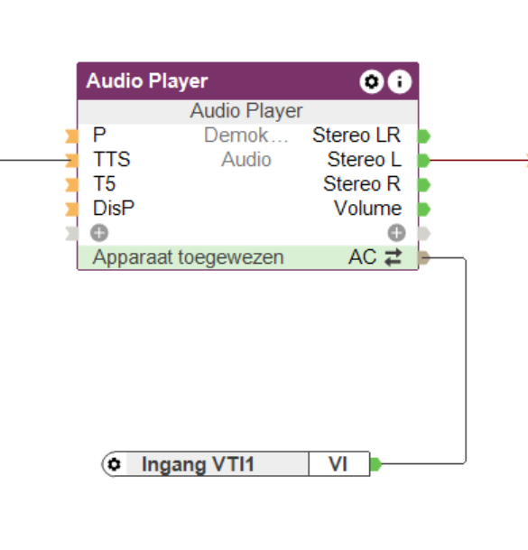

# PyLoxone

[](https://github.com/JoDehli/PyLoxone/releases/latest)


[](https://github.com/hacs/integration)

If you want to support my work on this binding you can buy me a coffee:

<a href="https://www.buymeacoffee.com/JoDehli" target="_blank"></a>


Home Assistant binding for Loxone. 

A special thanks to Pawel Pieczul from the great openhab2 house automation software. 
He really helped me a lot to with the new token based authentication. Thanks Pawel!!!

Minimum supported Home Assistant version: **2025.2.4**. Native Intercom Gen 2
cameras require **2026.11+** and its two-way camera API. Older versions continue
loading Loxone platforms, including Intercom sensors and controls, without
native cameras or camera token timers.


## Config for the gen2 miniserver
If you have the gen2 miniserver you should connect via local access. It is more reliable and faster than a cloud connection.

### Config for cloud connection
Please use this only in case local access is not possible.

Example:
- Miniserver Ip: https://dns.loxonecloud.com/123456789ABC
- Port: 443

Change 123456789ABC to your miniserver Serial Number.

## Manual installation
1. Download the zip file and extract all files.
2. Copy the ***custom_components*** folder in the same folder where your configuration.yaml is located
3. Restart Home-Assistant
4. Go to Configuration -> Integrations and search for Pyloxone
5. Add the Integration and fill out all required fields
6. Restart Home-Assistant

## Hacs installation
1. Install hacs to your homeassistant installation. See https://hacs.xyz/docs/use/download/download/
2. Add this repository to hacs: https://github.com/JoDehli/PyLoxone
3. Install the PyLoxone binding 
4. Restart Home-Assistant
5. Go to Configuration -> Integrations and search for Pyloxone
6. Add the Integration and fill out all required fields
7. Restart Home-Assistant

## Supported Loxone Entities
Currently, this integration supports the following Loxone entities by mapping them to Home Assistant entities.
If you encounter a Loxone entity that is currently not supported, you can post a feature request so it can be looked into.

- InfoOnlyAnalog and InfoOnlyDigital
- Switch, TimedSwitch and Pushbutton
- Jalousie, Window and Gate
- Intercom
- Intercom Gen 2 (ringing, controls and diagnostics; camera on Home Assistant 2026.11+)
- LightControllerV2
- Alarm
- Fan
- RoomController and RoomControllerV2
- AudioZoneV2
- Slider and ValueSelector (Up-Down Buttons)
- TextInput
- Radio Buttons

## Known Limitations

- Pushbuttons are stateless. They can not be used to reliably trigger automations. Use a Switch as a workaround and turn it off again in the Automation or in Loxone itself.

## Intercom Gen 2 (experimental)

### Sensors and controls

Native local `IntercomV2` devices are discovered automatically through the
existing PyLoxone entry. These entities work on every supported HA version:

| Entity | Purpose |
| --- | --- |
| Ringing binary sensor | Tracks the bell's ringing state for dashboards and automations |
| Mute doorbell switch | Mutes/unmutes the Loxone bell; state follows Miniserver feedback |
| Dismiss ringing button | Stops the bell without starting a conversation |
| Configured output buttons | Pulse the output subcontrols exposed by Loxone, such as a door release |
| Play reply buttons | Play the voice replies configured in Loxone; each button shows its message as an attribute |
| Online binary sensor | Reports whether the Intercom device is ready |
| Device status sensor | Distinguishes unknown, online, rebooting and initializing states |
| Firmware sensor | Optional diagnostic entity, disabled by default; firmware also appears in device information |

Only available states and configured actions are exposed. Outputs must first be
configured and visible to the account in Loxone; no door-release action is
invented. An output pulse does not report whether a physical door is locked.
PIN-protected outputs are not exposed as ordinary buttons; use the existing
`loxone.event_secured_websocket_command` action with the required code. Locked
controls cannot be operated through these buttons or the mute switch.

Mute doorbell affects the Loxone bell, independently of the browser microphone.
Reply buttons follow their configured slot, retaining identity when the text is
edited. Removing a reply makes its button unavailable until that slot is used
again. No voice reply or output is triggered automatically during discovery.

For ringing notifications, use a state trigger from `off` to `on` on the Ringing
sensor. The signal represents active ringing; repeated presses while it remains
active do not imply separate button-press events.

### Live camera

On Home Assistant 2026.11 or newer, PyLoxone automatically creates a camera for
each native `IntercomV2` device exposed to the configured Loxone account. Add or
reload PyLoxone through **Settings → Devices & services**; no camera YAML,
separate Intercom credentials, or token file is required. Earlier HA versions
skip these cameras and continue loading the existing platforms.

The camera uses the existing Miniserver connection for discovery and automatic
issuance of a dedicated permission-0 Intercom token. Device and
entity IDs use the Miniserver identity and Intercom UUID, so DHCP address
changes preserve entity IDs, dashboard references and user customizations.
The Intercom is grouped under its Miniserver and uses its Loxone room as the
suggested area. It becomes available after the Miniserver reports a valid
device address and online state. Disconnects close its media sessions.

Open the camera's more-info dialog for live video and listening. Two-way audio
also requires enabling the camera preview under **Settings → System → Labs**,
HTTPS access to HA, and browser microphone permission. Chrome has been tested;
embedded browsers may behave differently. Use a tile that opens more-info
rather than keeping an audio stream running in a background dashboard card:
the Intercom allows only one audio call at a time. PyLoxone does not interrupt
another call to obtain the audio slot.

This implementation supports local native Gen 2 devices. Trust connections,
custom `IntercomV2` devices and snapshots are not supported. Testing has used
Intercom firmware `17.00.06.01` and Miniserver `17.3.10.27`.
See the [Intercom test record](docs/intercom-testing.md) for automated coverage,
hardware checks and remaining limits.

If negotiation stalls, PyLoxone reports a timeout and releases the session.
Disconnects, device-ended calls and invalid signalling also close the affected
session. A busy audio slot is reported without forcing another caller off.
After the other call ends, close and reopen the camera to retry.

### Intercom authentication

PyLoxone requests a dedicated token when the camera is first opened, using the
existing account credentials over its encrypted Miniserver connection. Permission
`0` is intended for Intercom authentication; the main app token is never passed
to the Intercom. Cameras belonging to the same entry share this dedicated token.

The token and a stable client UUID are stored separately in HA's config entry,
reused after reloads/restarts, and renewed automatically before expiry. Temporary
network failures retry after one minute. A revoked token is replaced when the
Miniserver rejects renewal or the Intercom rejects authentication; device
authentication retries once. Rejected account credentials or permissions stop
automatic retries, and users should check the existing PyLoxone account settings.

Unload cancels renewal work and retains the token. Removing the integration
attempts to revoke its dedicated token using a short-lived Miniserver connection;
if the Miniserver is unreachable, the token expires naturally. Tokens are not
exposed in camera state attributes, diagnostics, or the frontend.

On the tested firmware, the Intercom still accepted an issued JWT immediately
after Miniserver revocation. Revocation is therefore best effort and must not
be relied on to immediately prevent new camera sessions or terminate a call.

## LightControllerV2 Sub-Controls

Each `LightControllerV2` in Loxone groups individual lighting outputs (dimmers, color pickers, switches) as sub-controls. These are registered in the Home Assistant entity registry but **disabled by default** to keep the UI clean.

To access individual light outputs:

1. Open **Settings → Devices & Services → Entities**
2. Filter by your LightControllerV2 device
3. Enable the sub-control entities you want to use (dimmer, color picker, etc.)

The integration option **"Generate sub-controls for LightControllerV2"** controls the default enabled state for newly created sub-control entities. When enabled, new sub-controls start as enabled; when disabled (the default), they start as disabled but remain visible in the entity registry for manual activation.

## Sensor Device Class Detection

Sensors (InfoOnlyAnalog, Meter) are automatically classified based on their unit and Loxone category/name. The following device classes are detected:

| Device class | Detected by |
|---|---|
| `temperature` | Unit: °C, °F |
| `humidity` | Unit: % **and** category or name contains "humidity", "vlhkost", "feucht", or "humidité" |
| `battery` | Unit: % **and** name contains "batt", "akku", or "battery" |
| `energy` | Unit: kWh, Wh, MWh |
| `power` | Unit: W, kW |
| `volume_flow_rate` | Unit: L/h, L/min |
| `water` | Unit: L |
| `illuminance` | Unit: lx, Lx, lux |
| `carbon_dioxide` | Unit: ppm |
| `wind_speed` | Unit: km/h |

Sensors with `%` unit that don't match any keyword are left without a device class.

### Overriding the detected device class

If the automatic detection assigns the wrong device class (or you want to set one for an unclassified sensor), use Home Assistant's built-in [entity customization](https://www.home-assistant.io/docs/configuration/customizing-devices/) in `configuration.yaml`:

```yaml
homeassistant:
  customize:
    sensor.my_percentage_sensor:
      device_class: battery
  customize_glob:
    sensor.*humidity*:
      device_class: humidity
```

## Log Configuration
Use the following settings if you paste a log into a issue:

```yaml
logger:
  default: warning
  logs:
    homeassistant: warning
    homeassistant.helpers: warning
    custom_components.loxone: debug
    custom_components.loxone.api: debug
```

## Recorder Configuration
A Loxone system generates a few thousand events per day. These events are recorded in your homeassistant and the database file can grow a lot per day. It is recommended to exclude loxone events from the recorder using the following settings:

```yaml
recorder:
  exclude:
    event_types:
      - loxone_event
```

## Websocket direct command service
If you want to send data directly to Loxone inputs or blocks that are not (yet) supported, you can use this service to send a command:

```yaml
{
"uuid":"0f1e0b31-0179-7f77-ffff403fb0c34b9e",
"value":"pulse"
}
```
You can choose to send the commands using the UUID or the entity-name. See Developer Tools -> Services for more details.
Websocket direct commands enable you to, for example, send data captured by devices integrated in Home Assistant immediately to the miniserver using a VI on the miniserver.

## Some examples

### Using a TextInput to control a block's API Connector

The TextInput Virtual Input in the Miniserver enables some neat advanced applications.  
The Audioserver for example, has limited API-support. If you want to switch presets from Home Assistant, this is not possible using the traditional Audio Player API interface.

A neat way around this, is by adressing the Audio Player block's API Connector using a VTI (Virtual Text Input). This enables all of the block's functionality in Home Assistant.

First, create a VTI and connect it to the block's API Connector.



Second, send anything you want to this VTI from Home Assistant. In this use case, we want the Audio Player to switch to preset 4:

```
service: loxone.event_websocket_command
data:
  value: SET(Ap;Fav;4)
  device: text.ingang_vti1
```
You can even directly address the Audio Player's TTS engine.
```
service: loxone.event_websocket_command
data:
  device: text.ingang_vti1
  value: SET(AP;TTS;Woop-woop, that's the sound of da police)

```
### Using a Slider to send data from Home Assistant to the Loxone Miniserver

The Miniserver connects to/interfaces with a wide range of third party devices and services. However, support is quite limited in comparison to Home Assistant.  
If you take the DSMR P1 digital meter interface for example. This (serial) interface is supported on a wide range of platforms, but not on the Miniserver.  
A workaround could be creating a VI on the Miniserver and configuring it as a Slider. This VI will then appear in this integration as a Number entity to which you can send any numerical value.  
Any change in the sensor value in Home Assistant should trigger an automation that sets the new value to the entity in the Loxone integration.

## Advanced usage: what to do if your device is not supported
You can integrate nearly every Loxone Entity in your Home Assistant system by adding a custom sensor to your yaml file. 

### Example 1 with a RoomComfortTemperature
Here is a example of a sensor which is displaying the comfort temperature of a room controller v2:
```yaml
sensor:
  - name: RoomComfortTemperature
    platform: loxone
    uuidAction: "15beed5b-01ab-d81d-ffff2b06d5b9c660"
    unit_of_measurement: "°C"
    device_class: "temperature"    # Use device classes from homeassitant for example temperature, humidity, voltage   
    state_class: "total"           # measurement, total or total_increasing see https://developers.home-assistant.io/docs/core/entity/sensor/#long-term-statistics
```
In this example a sensor with the name roomcomforttemperature (sensor.roomcomforttemperature) is created. The sensor is listening to all events from the loxone system with the specified uuid ([How do you get the uuid?](https://github.com/JoDehli/PyLoxone?tab=readme-ov-file#how-do-you-get-the-uuid)).

You can also send any websocket to a loxone entity for example to increase and decrease the temperature of a room controller v2. Here is a script that raises and lowers the temperature in 0.5 °C steps:

```yaml
script:
  tempup:
    alias: TempUp
    mode: single
    sequence:
    - data_template:
        uuid: "15beed5b-01ab-d81f-ffff403fb0c34b9e" 
        value: "setComfortTemperature/{{ states('sensor.roomcomforttemperature')|float+0.5}}"
      service: loxone.event_websocket_command
  tempdown:
    alias: TempDown
    mode: single
    sequence:
    - data_template:
        uuid: "15beed5b-01ab-d81f-ffff403fb0c34b9e"
        value: "setComfortTemperature/{{ states('sensor.roomcomforttemperature')|float-0.5}}"
      service: loxone.event_websocket_command
```

### Example 2 with a UpDownAnalog

- First get the uuidAction as described above for example. Let's assume your uuidAction for the UpDownAnalog is 152ecfaa-03ac-f715-ffff403fb0c34b9e.
- Create a Sensor do display the current value of the UpDownAnalog like this:
```yaml
sensor:
  - name: "Up and Down Sensor"
    platform: loxone
    uuidAction: "152ecfaa-03ac-f715-ffff403fb0c34b9e"
    unit_of_measurement: ""
```
- Create a script for incrementing up and down like this:
```yaml
down:
  alias: Down
  mode: single
  sequence:
  - data_template:
      uuid: "152ecfaa-03ac-f715-ffff403fb0c34b9e"
      value: "{{ states('sensor.up_and_down_sensor')|float-1}}"
    service: loxone.event_websocket_command

up:
  alias: Up
  mode: single
  sequence:
  - data_template:
      uuid: "152ecfaa-03ac-f715-ffff403fb0c34b9e"
      value: "{{ states('sensor.up_and_down_sensor')|float+1}}"
    service: loxone.event_websocket_command
```

The commands for each entity can be found in the structure file. You can download it from the [Loxone Homepage](https://www.loxone.com/dede/kb/api/).

## How do you get the uuid?

If you need the UUID of an entity to use it in a service call or to manually add it to Home Assistant, you can get it from your Loxone setup by visit the following site with your prefered browser:

```
http://{ip-address-of-your-loxone}:{port}/data/LoxAPP3.json

{ip-address-of-your-loxone} --> replace with the ip of your loxone 

{port} --> replace with your port (default: 80)
```
After entering your username and password you will see your LoxApp3.json. You can paste it in your prefered JSON editor/viewer (eg. https://jsonformatter.org/). 
In this file you can find all your uuid ids for all your devices.  


Here is a example of a Room Controller V2: 
```json
        "15beed5b-01ab-d81f-ffff403fb0c34b9e": {
            "name": "Intelligente Raumregelung",
            "type": "IRoomControllerV2",
            "uuidAction": "15beed5b-01ab-d81f-ffff403fb0c34b9e",
            "room": "13efd3e5-019d-8ad2-ffff403fb0c34b9e",
            "cat": "152c22de-0338-94b5-ffff403fb0c34b9e",
            "defaultRating": 2,
            "isFavorite": false,
            "isSecured": false,
            "details": {
                "timerModes": [
                    {
                        "name": "Anwesend",
                        "description": "Komfortbetrieb",
                        "id": 1
                    },
                    {
                        "name": "Abwesend",
                        "description": "Sparbetrieb",
                        "id": 0
                    },
                    {
                        "name": "Aus",
                        "description": "Geb\u00e4udeschutz",
                        "id": 2
                    }
                ],
                "format": "%.1f\u00b0",
                "connectedInputs": 0
            },
            "states": {
                "tempActual": "15beed5b-01ab-d7f7-ffff2b06d5b9c660",
                "tempTarget": "15beed5b-01ab-d81d-ffff2b06d5b9c660",
                "comfortTemperature": "15beed5b-01ab-d7ff-ffff2b06d5b9c660",
                "comfortTolerance": "15beed5b-01ab-d800-ffff2b06d5b9c660",
                "absentMinOffset": "15beed5b-01ab-d801-ffff2b06d5b9c660",
                "absentMaxOffset": "15beed5b-01ab-d802-ffff2b06d5b9c660",
                "frostProtectTemperature": "15beed5b-01ab-d803-ffff2b06d5b9c660",
                "heatProtectTemperature": "15beed5b-01ab-d804-ffff2b06d5b9c660",
                "activeMode": "15beed5b-01ab-d7f1-ffff2b06d5b9c660",
                "comfortTemperatureOffset": "15beed5b-01ab-d7ec-ffff2b06d5b9c660",
                "overrideEntries": "15beed5b-01ab-d7ed-ffff2b06d5b9c660",
                "prepareState": "15beed5b-01ab-d7ee-ffff2b06d5b9c660",
                "useOutdoor": "15beed5b-01ab-d7ef-ffff2b06d5b9c660",
                "operatingMode": "15beed5b-01ab-d7f2-ffff2b06d5b9c660",
                "overrideReason": "15beed5b-01ab-d7f4-ffff2b06d5b9c660",
                "openWindow": "15beed5b-01ab-d7f8-ffff2b06d5b9c660",
                "modeList": "15beed5b-01ab-d7f3-ffff2b06d5b9c660"
            },
            "subControls": {
                "15beed5b-01ab-d7eb-ffff2b06d5b9c660": {
                    "name": "Heating and Cooling",
                    "type": "IRCV2Daytimer",
                    "uuidAction": "15beed5b-01ab-d7eb-ffff2b06d5b9c660",
                    "defaultRating": 0,
                    "isFavorite": false,
                    "isSecured": false,
                    "details": {
                        "analog": true,
                        "format": "%.1f\u00b0"
                    },
                    "states": {
                        "entriesAndDefaultValue": "15beed5b-01ab-d7eb-ffff2b06d5b9c660",
                        "mode": "15beed5b-01ab-d81e-ffff2b06d5b9c660",
                        "modeList": "15beed5b-01ab-d7f3-ffff2b06d5b9c660",
                        "value": "15beed5b-01ab-d7f1-ffff2b06d5b9c660"
                    }
                }
            }
        },
```


## Development and compatibility tests

The full test suite runs in CI against three pinned environments:

| Home Assistant | Python | Test plugin |
| --- | --- | --- |
| 2025.2.4 | 3.13 | `pytest-homeassistant-custom-component==0.13.214` |
| 2026.10.4 | 3.14.2+ | `pytest-homeassistant-custom-component==0.13.375` |
| 2026.11.0b4 | 3.14.2+ | `pytest-homeassistant==2026.11.0b4` |

The 2026.11 target uses HA's official test package. It must not be installed
alongside the legacy custom-component test plugin. Each target gets its own
`.venv-test-<version>`; the live HA runtime and its credentials stay separate.

```sh
LOXONE_TEST_HA=2025.2.4 LOXONE_PYTHON=python3.13 ./scripts/test -q
LOXONE_TEST_HA=2026.10.4 LOXONE_PYTHON=python3.14 ./scripts/test -q
LOXONE_PYTHON=python3.14 ./scripts/test -q  # default: 2026.11.0b4
```

Camera tests need the system TurboJPEG library (`libturbojpeg` on Ubuntu 24.04,
`jpeg-turbo` with Homebrew on macOS); the matching Python/media dependencies
are included in each target's requirements. `LOXONE_TEST_VENV` can override the
environment path. The runner rejects a mismatched HA version, Python version
or test plugin rather than silently running a different target.

Python source and formatting target 3.13 so changes remain importable on the
minimum HA version. Native camera tests are skipped on older HA targets;
existing-platform, protocol, token and setup/reload/unload tests still run.
Tests use synthetic Miniserver configuration and never need home credentials.
The 2026.11 beta is an explicitly pinned development target, not an automatic
upgrade of an installed HA instance.
