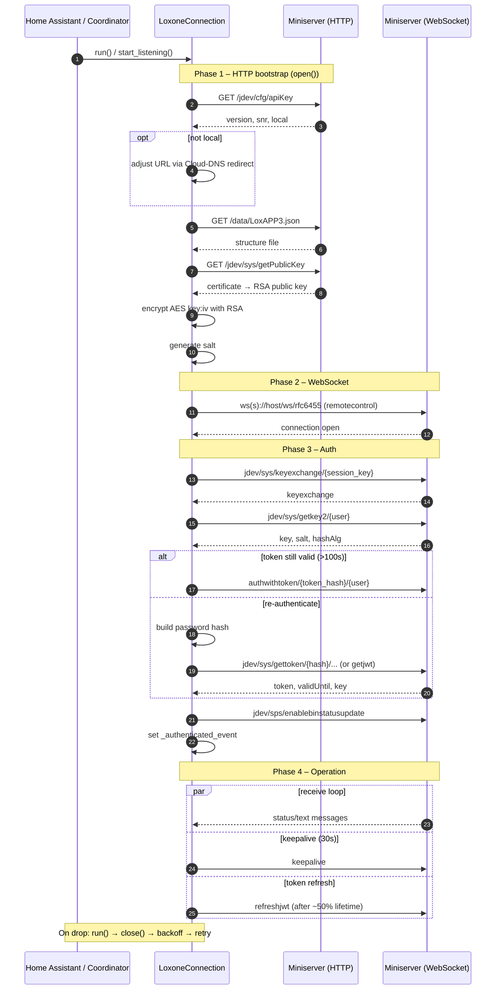

# Loxone Miniserver – Connection Flow (Connect)

Source: [Communicating with the Miniserver](https://www.loxone.com/wp-content/uploads/datasheets/CommunicatingWithMiniserver.pdf) (Loxone) and `pyloxone_api` (`src/pyloxone_api/connection.py` im Paket-Repo).

## Quick overview

1. **HTTP bootstrap (`open()`)**: check reachability, load the structure file + public key, RSA-encrypt the AES session key, open the WebSocket.
2. **WebSocket authentication (`start_listening()` / `_websocket_event()`)**: key exchange → `getkey2` → token auth or token acquisition → enable updates.
3. **Operation**: receive loop, keepalive (30 s), token refresh, encrypted/secured commands.
4. **Supervision (`run()`)**: reconnect/backoff, escalation on auth errors.

## Phase 0 – Preparation (constructor)

- Parse host/port/scheme, normalize the URL.
- Generate the AES-256-CBC key (`_aes_key`, 32 bytes) and IV (`_iv`, 16 bytes) per instance.
- Take over an existing token cache if present.
- Create the message queue, salt state and visual-hash state.

## Phase 1 – HTTP bootstrap (`open()`)

With bounded exponential backoff (`_get_with_retry`, 5 attempts):

1. `GET /jdev/cfg/apiKey` → version, SNR, `local`.
   - If `local == false`, adjust the URL via Cloud-DNS redirect (`_apply_url`).
2. `GET /data/LoxAPP3.json` → structure file into `structure_file`.
3. `GET /jdev/sys/getPublicKey` → certificate → RSA public key.
4. Build the session key: encrypt the payload `"{aes_key_hex}:{iv_hex}"` with RSA PKCS#1 v1.5, Base64 → `_session_key`.
5. Generate the salt (`_generate_salt`).

## Phase 2 – Open WebSocket

- URL `ws(s)://{host}/ws/rfc6455` (`build_loxone_url`), subprotocol `remotecontrol`.
- `ping_interval=None` (the Loxone keepalive is the liveness channel).

## Phase 3 – Authentication

1. Immediately after connect: `jdev/sys/keyexchange/{session_key}`.
2. Response `keyexchange` → sends `jdev/sys/getkey2/{encoded_username}`.
3. From the response: `key`, `salt`, `hashAlg`.

Branching:

- **Token still valid** (> 100 s remaining lifetime): hash over the token → `authwithtoken/{token_hash}/{user}`.
- **Token missing/expired**: password hash → `jdev/sys/gettoken/{hash}/...` (or `getjwt` from FW 10.2). The response provides `token`, `validUntil`, `key`.

Completion: `_authenticated_event.set()`, token-change callback, `jdev/sps/enablebinstatusupdate`.

## Phase 4 – Operation

- **Receive loop**: parses the binary Loxone protocol (8-byte header + body, chunking/estimated length), dispatches to `_websocket_event()` and the HA callback.
- **Keepalive**: every 30 s (`KEEP_ALIVE_PERIOD`) `keepalive`; watchdog after 90 s without an incoming frame.
- **Token refresh**: after auth, wait ~50 % of the remaining lifetime, then `async_refresh_token`; escalate after 10 failed attempts.
- **Reconnect task**: on a reconnect event, `LoxoneTokenError` is raised.
- **Secured commands**: stash in `_secured_queue`, `jdev/sys/getvisusalt/{user}`, then send the HMAC command.

## Phase 5 – Supervision (`run()`)

- Loop over `open()`/`start_listening()`.
- Retryable errors → `close()`, backoff ±20 % jitter, retry.
- Auth errors → pass on to the integration (delete token / reload).
- `close()` sets the shutdown event and terminates.

## Flow diagram

## Error codes (from the docs)

- `401` / `4003`: unauthorized / too many failed attempts (close 4003).
- `420`: not authenticated within the first seconds.
- `400`: another command before auth.
- Further CloudDNS codes see the docs (403, 405, 409, 412, 418, 481–483).
